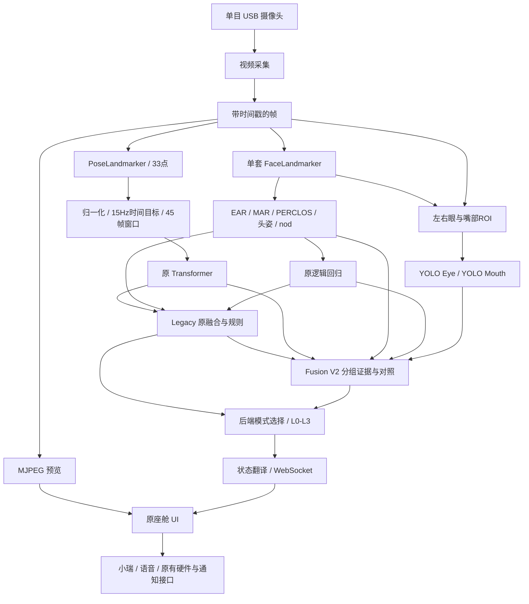
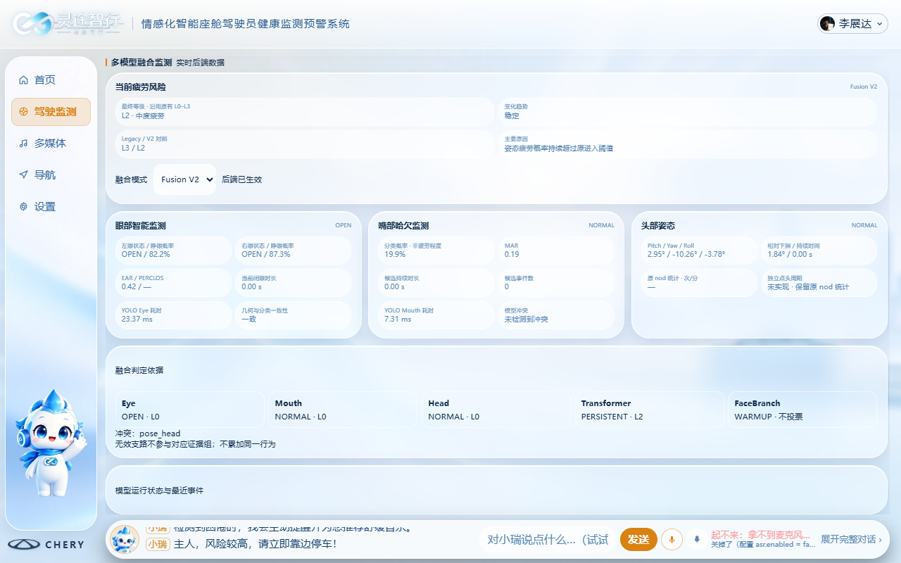

# 灵途智行 · Lingtu Zhixing

**面向智能座舱的多模型融合驾驶员状态感知与情感化交互系统。**

灵途智行从一颗单目摄像头出发，将人体姿态时序、面部几何和眼嘴视觉分类组织成可解释的疲劳证据，形成 L0–L3 风险判断，并通过原有座舱界面与助手「小瑞」反馈给驾驶员。系统把状态感知、分层预警和座舱交互连接起来，支持 Windows 研发验证与 RK3568 Ubuntu ARM64 边缘运行。

**项目贡献：时序行为建模 × 眼嘴精细感知 × 分组证据融合 × 情感化座舱交互。**

[PPT 交接入口](docs/presentation/PPT_HANDOFF.md) · [系统架构](docs/SYSTEM_ARCHITECTURE.md) · [算法说明](docs/ALGORITHM_ARCHITECTURE.md) · [实验索引](docs/validation/INDEX.md) · [部署现状](docs/DEPLOYMENT_STATUS.md)

## 核心技术

| 技术模块 | 实际能力与系统价值 |
|---|---|
| MediaPipe PoseLandmarker | 提取 33 个身体关键点，每点包含 xyz 与置信度，统一成 132 维姿态特征 |
| 时序 Transformer | 45×132 输入，15 Hz 时间目标，建模低头、点头及身体动作的时序变化；当前配置输出 normal / fatigue |
| MediaPipe FaceLandmarker | 一套 FaceMesh/478 点感知链路，复用关键点计算 EAR、MAR、PERCLOS、头姿并定位眼嘴 ROI |
| YOLO Eye | 224×224 图像分类，左右眼分别输出 Open / Closed 概率，与几何闭眼证据交叉核验 |
| YOLO Mouth | 224×224 图像分类，输出 Yawn / No Yawn；结合 MAR 与持续时间形成哈欠候选 |
| 面部逻辑回归 | 保留原 `(perclos, brate, nod)` 特征顺序和权重，按有效性及热身状态投票 |
| Legacy / Fusion V2 | 原规则与五组证据融合并行对照，相关证据不重复加分，包含冲突、时效、持续性和降级滞回 |
| 座舱交互 | aiohttp + WebSocket + MJPEG，驱动风险可视化、小瑞语音、导航、多媒体及原有硬件入口 |

YOLO 在 **Fusion V2 模式正式参与风险证据生成**：眼部支持几何一致的持续闭眼判断，嘴部支持持续哈欠候选。Shadow 模式用于保留 Legacy 最终结果的对照运行。两份公开权重均已实际加载确认是 **Classification**，不是目标框检测模型。

## 系统总体架构



采集、预览与推理解耦已在当前工作区和板端实施，采用单摄像头、容量 1 的最新帧槽位。该调度改动尚未纳入本次文档提交；已提交源码与实机工作副本的边界见[发布与工程状态](docs/DEPLOYMENT_STATUS.md)。

## 算法与风险决策

Pose 支路以时间窗口识别行为趋势；Face 支路提供眼睑、嘴部、头姿与长期统计；YOLO 增加局部图像外观证据。Fusion V2 分别生成 Eye、Mouth、Head/Posture、Transformer、FaceBranch 五组证据，再进行序数等级合成。

EAR 与 YOLO Eye、MAR 与 YOLO Mouth 使用相关图像信息，组内进行一致性检查；Eye 与 LR 的相关证据取最大值。单次哈欠的嘴部证据最高 L1，持续严重闭眼或持续头姿与时序共识可支持 L3。每路同时表达 valid、timestamp、stale、warmup 和冲突，模型缺失不伪装为正常。两路 YOLO 均不可用时回退到原 Legacy 等级。

| 等级 | 风险含义 |
|---|---|
| L0 | 正常驾驶 |
| L1 | 轻度疲劳 |
| L2 | 中度疲劳 |
| L3 | 重度疲劳 |

完整规则、原 Legacy 公式、输入输出、后端切换门槛及协议见[算法架构](docs/ALGORITHM_ARCHITECTURE.md)和 [Fusion V2 技术说明](docs/FUSION_V2.md)。融合输出是规则定义的风险等级，`confidence=null`，不把分类概率解释为总体疲劳概率。

## 座舱 UI 与交互



上图为真实 PC 视频回放会话截图：包含眼部、嘴部、头姿、证据组、模式及热身状态；风险标签是系统输出。原有浅色渐变、导航、卡片、小瑞形象及布局保持。

座舱保留驾驶监测、多媒体、导航、设置和语音入口；多模型面板增量加入原监测页。模式切换由后端确认，并在新决策到来后生效。语音链路包含唤醒、流式识别、3 秒停顿提交及播放反馈；导航覆盖搜地点、选起终点、比较路线和开始引导。

[UI 说明](docs/UI_V2.md) · [语音交互](docs/VOICE_INTERACTION.md) · [小瑞音色](docs/VOICE_PROFILE.md) · [导航流程](docs/NAVIGATION_FLOW.md) · [素材索引](docs/presentation/PPT_ASSET_INDEX.md)

## 硬件与边缘部署

主平台为 **KICKPI K1-MINI V2.2 / RK3568B2 / 4 GB RAM / 32 GB eMMC**，配套 10.1 英寸 MIPI 触摸屏、USB UVC 摄像头和 850 nm 红外补光硬件。红外场景识别质量与板端音频闭环分别验收。

Ubuntu **24.04.4 ARM64 / Linux 6.1.141** 已从 eMMC 根分区运行。Pose、Face、Transformer、YOLO Eye/Mouth 五个原模型独立加载与推理通过；原 UI 与 WebSocket 已运行。X11 逻辑视口 **1280×800**，原面板模式保持 800×1280，Goodix 触摸经用户确认，重启后自动横屏实测通过。

原心率扩展接口继续保留：HPM5300EVK + MAX30102、DMA 四相位状态机与串口采集链路属于既有扩展模块，DMS 视觉主链路由单主控运行。该模块的当前用户修改未纳入本次文档发布，板端心率联调另行验收。

## 实验与验证成果

| 论证目标 | 实际证据 | 说明 |
|---|---|---|
| 保护原算法行为 | 294 次视频决策、19 列零差异 | normal 167 + fatigue 127，原链路逐决策对拍 |
| 融合规则可回归 | 512 种原融合组合 | 覆盖等级、闸门、规则组合 |
| 软件工程完整性 | 67 项 PC 基线；调度阶段扩展到 76 项通过 | 覆盖原67项及9项调度/失效测试；本次复核日志见资料更新报告 |
| 眼部外观分类 | MRL 371 张，356 张正确，95.96% | s0034–s0037 参与者子集；统计口径见实验资料 |
| 导出数值保持 | 同输入 PT→ONNX：Eye 最大差 2.98e-7，Mouth 1.10e-6 | 固定张量，各 6 样本 |
| 融合解释可追踪 | YawDD 663 次决策、260 次有效 LR 投票 | 同步记录 Legacy/V2、冲突与等级原因 |
| ARM64 可执行性 | 五模型独立推理；Transformer 与两路 YOLO 数值对拍通过 | 使用已有固定输入与原权重 |
| 调度与显示落地 | RK3568 短时预览约 13.53 FPS、推理约 1.49 FPS、独立决策约 1.09 FPS | 408 张 JPEG / 30.16 s；X11 横屏与触摸已运行 |

以上分别证明规则保护、分类能力、导出一致性、融合可解释性与边缘运行能力。完整数据范围、原始报告索引及资源口径见[实验与演示资料](docs/presentation/DEMO_AND_EXPERIMENTS.md)。

## 快速开始

### Windows：复用现有环境

已有 DMS 环境的电脑双击 **`ui/run_ui.bat`**；该入口按用户选择默认 V2。`ui/run_ui_legacy.bat` 回到 Legacy；库级 `config.py` 默认仍为 Legacy。打开驾驶监测页后点击“连接摄像头”，避免同时启动另一个占用摄像头的程序。

```powershell
conda activate dms
python ui/server.py --source demo   # 仅界面演示，不代表模型实测
# 已有权重与依赖时，使用原启动器开启真实摄像头
.\ui\run_ui.bat
```

新环境请先阅读[依赖和平台说明](docs/PC_LINUX_COMPATIBILITY.md)。旧 `requirements.txt` 是早期开发清单，不能独立重建当前全部 UI/语音环境；MediaPipe 路径使用 OpenCV contrib，环境中只保留一种 cv2 发行包。YOLO 权重不随仓库发布，使用[原下载与哈希核验工具](docs/YOLO_SHADOW.md)准备；ONNX 导出在 PC 开发环境执行。

### Linux：已安装并核验依赖后

```bash
# 从项目根目录启动；设备路径须以实机枚举结果为准
export DMS_PYTHON="$PWD/.venv/bin/python"
export DMS_CAMERA_DEVICE=/dev/video10
bash ui/run_ui.sh --mode legacy
# 退出旧服务后，可选择 shadow 或 v2
# bash ui/run_ui.sh --mode shadow
# bash ui/run_ui.sh --mode v2
```

访问 `http://127.0.0.1:8765/index.html`。Linux 脚本默认 Legacy，支持日志，V2 保留源码哈希和策略匹配门槛。ARM64 requirements/constraints、额外依赖和逐级验收见[部署状态与操作入口](docs/DEPLOYMENT_STATUS.md)。

## 项目创新与应用价值

- **算法协同**：将身体时序、面部几何和局部图像分类组合为分组证据，以持续性与共识解释风险。
- **系统闭环**：风险等级、变化原因、模型有效性和座舱反馈共享同一后端决策，实现可观察的感知—决策—交互链路。
- **工程落地**：保留可回退 Legacy、确定性对拍和跨平台边界，在单主控 ARM64 平台复用原模型与原 UI。

## 工程状态与后续验收

截至 2026-11-04 的资料核对，最新实机证据采自 2026-11-02。完整 CPU 推理未达 15 Hz；上次高负载最高约 81.7℃，已停止负载并降至约 51–53℃。两路 YOLO 的 0.5 秒时效保护在低吞吐异步链路中持续失效，需完成既有同步选项对照；不放宽判决阈值。MediaPipe 跨架构严格数值对拍、摄像头重连复测、长期散热、板端语音及其他外设联调集中列于[当前工程状态](docs/DEPLOYMENT_STATUS.md)。

MRL 子集结果不代表端到端疲劳准确率；YawDD 无可靠逐帧风险标签，未计算误报率、漏报率或真实检测延迟。公开权重训练集重叠与许可待确认，模型不打包分发。未开展 RKNN、NPU 或 INT8 部署。

## 资料导航

```text
src/                 原感知、时序模型、ROI分类、Legacy与V2
ui/                  原座舱、WebSocket、摄像头、音频与语音
tools/               推理、回归、依赖审计与固定输入对拍
models/              Tasks及LR；YOLO公开权重按说明另取
docs/presentation/   可直接用于PPT制作与答辩的交接资料
docs/validation/     PC验证、规则对照及报告索引
docs/DEPLOYMENT_STATUS.md   当前ARM64部署与性能验收状态
hr/                  既有心率扩展接口与固件资料
```

[完整历史技术指南](README_LEGACY.md)保留原录制、训练、标定及工程笔记；当前展示与部署采用本页及新资料索引。源码和素材的公开访问不自动赋予第三方模型或素材再分发许可，参见[PPT 素材说明](docs/presentation/PPT_ASSET_INDEX.md)。
