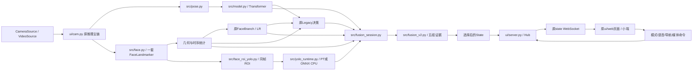
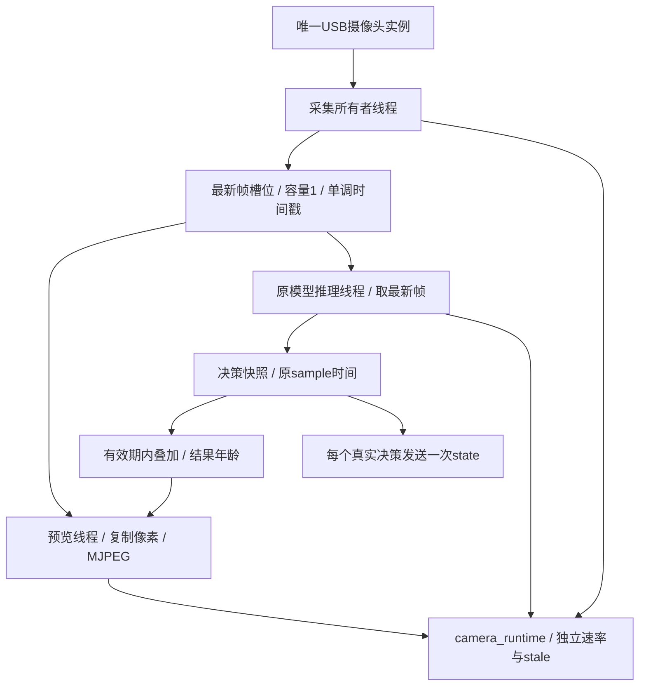

# 系统架构：从视觉证据到座舱交互

灵途智行以同一视频源承载人体、面部与眼嘴视觉感知，以后端风险状态连接座舱展示与语音。系统的核心贡献是让多个观测尺度形成可解释、可对照、可回退的决策链路。

## 模块关系

`src/fuse.py` 是独立 Legacy 参考入口；`src/live.py` 是姿态支路入口。Fusion V2 的集成在 `ui/cam.py` 和 `fusion_session.py`，不能把 `FUSION_MODE=v2` 理解为旧 fuse.py 已被替换。

## 运行边界

| 层 | 真实职责 | 输入/输出 |
|---|---|---|
| 采集 | Windows DirectShow、Linux V4L2、其他自动选择 | 原 BGR 帧、源时间 |
| 感知 | Pose、Face、复用 Face ROI 的 YOLO | 关键点、几何、分类概率及有效性 |
| 时序 | 原15Hz时间目标、45帧窗口与面部滚动统计 | Transformer posterior、PERCLOS、brate、nod |
| 决策 | 原 Legacy 与独立 V2；后端控制选用模式 | L0–L3、证据组、冲突和原因 |
| 翻译与传输 | ui/state.py 派生显示状态，server 转发 | 原 state 加可选 fusion_v2 / yolo / yolo_shadow |
| 交互 | 原 HTML/CSS/JS、小瑞、音频、导航与多媒体 | 显示及原有命令 API |

原 CSV 跟随和 demo 数据源继续保留。Demo 用于界面演示，CSV 用于回放；缺少模型观测时不生成虚构 V2 证据。启动 `--source cam` 提供摄像头入口，仍需用户点击连接才打开设备。

## 实机调度扩展

本图对应当前工作区与板端性能改造，源码仍是待单独提交的已有改动。本轮发布资料，不把它混入文档提交。推理跳过旧采集帧而不排队累积；预览不修改模型输入像素；断连清空画面并标记失效。Capture、Preview、Inference、Decision 分别计数，独立诊断消息不能冒充新风险决策。

## 协议与集成

原 `state` 字段兼容；`fusion_v2` 包含 mode、legacy_level、fusion_v2_level、final_level、五组 evidence、risk_reasons、conflicts、runtime。`yolo` 包含左右眼概率/状态、嘴部概率/状态、valid、timestamp、stale 与实际耗时。模式命令返回 `ok` 与 `effective=next_decision`，界面等待实际决策。

性能工作副本另有可选 `camera_runtime` 消息，用于显示速率、队列、丢帧、结果年龄及模型耗时。模型的 source timestamp 与页面接收时刻分开；刷新页面不能刷新一条旧证据。

## 部署与安全边界

视觉推理在 K1-MINI 单主控运行，CPU 后端，原模型不更换。导航及在线对话按配置使用外部服务；视觉疲劳推理不依赖这些服务。API key、用户配置、摄像头人像、固件和第三方权重不纳入本次资料分发。原心率扩展串口与灯光/通知接口继续保留，不是视觉感知的额外计算主控。

[算法架构](ALGORITHM_ARCHITECTURE.md) · [部署状态](DEPLOYMENT_STATUS.md) · [PPT 架构页](presentation/SYSTEM_ARCHITECTURE.md)
