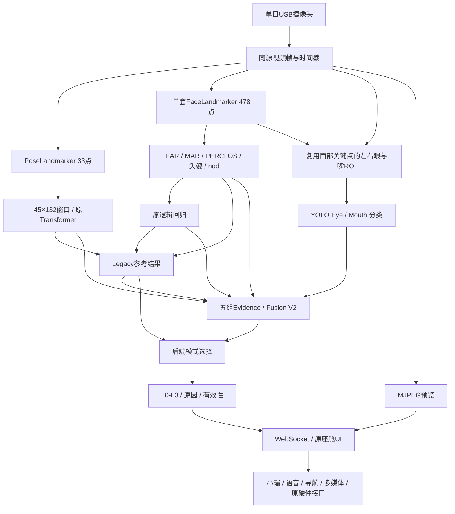

# PPT系统架构页

下图适合直接复制到支持Mermaid的工具，或渲染成矢量图用于PPT。所有箭头对应当前实际模块关系。

## 图下注释

- Transformer时间目标15Hz，不代表RK3568实测15FPS。
- ROI直接使用同一FaceLandmarker；不增加第二套面部模型。
- YOLO分类正式参与V2；Shadow仍选Legacy最终结果。
- MJPEG预览与风险数据分开传输；独立调度是已部署工作副本成果，尚待单独源码提交。
- WebSocket是数据传输，UI不重新计算风险；语音/导航/媒体属于交互层，不能画成疲劳模型输入。

## 硬件侧布局建议

一张K1-MINI实物照片连接摄像头、10.1寸MIPI触摸屏与音频外设，框内标Ubuntu ARM64、CPU五模型与Web服务。红外补光作为配套硬件，不标成已完成夜间准确率验证。心率是既有可选串口扩展，勿画为视觉推理必需的第二主控。

[模块与接口完整版](../SYSTEM_ARCHITECTURE.md) · [素材待补清单](PPT_ASSET_INDEX.md)
